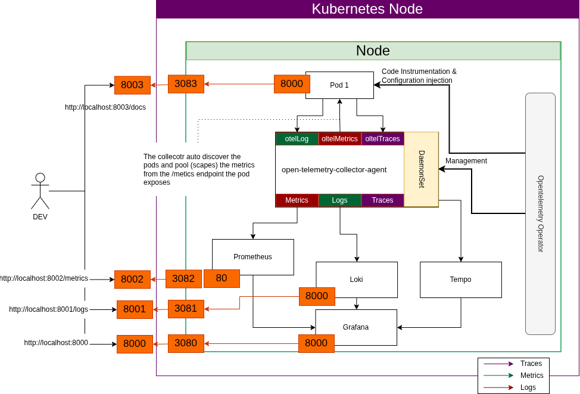

# Simple python open telemetry with grafana stack example

The project shown the simplest configuration I could build to create a full observability stack project using able to run locally using `kind`.

Requirements:

- `kind`
- `kubectl`
- `helm`
- internet connection

Main goals are to use the `optenetemetry-operator`  to configure the `opentelemetry-collector` and use `auto-instrumentation` to minimize the impact of the Opentelemetry support into the source code.

The [installation guide](docs/observability_installation_procedure.md) guide to the following steps:

- kind cluster setup
- installation of Opentelemetry:
  - operator
  - collector
  - Instrumentation
- install the Grafana stack  (Tempo, Loki, Prometheus and Grafana dashboard)
- build and deploy the [hello world application](./hello-world-example/) 
- verify the metrics, traces and logs are available on either the OtelCollector logs (using the standard debug exporter) and the 

The architecture is explained in the [observability architecture](./docs/observability.md) document.

## Port Mapping
The current `cluster.yaml` preconfigure the mapping according to the diagram.

