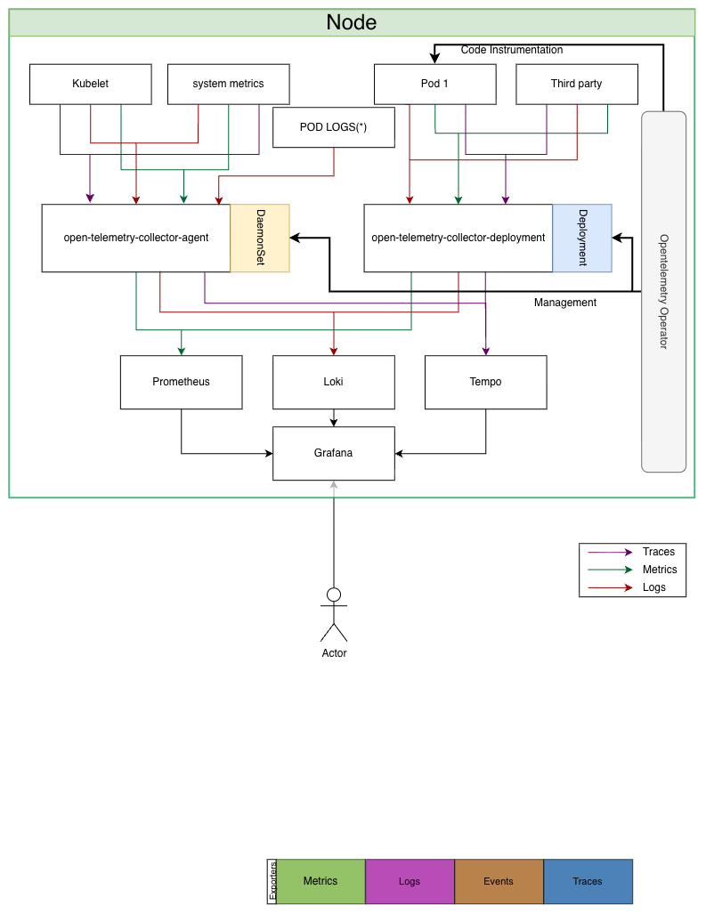

# Planning

## Observability

Monitor a system in production is more than just verify if the services are up & running or check the logs to troubleshoot problems.

Observability components:

- *logs*: to troubleshoot issue, are providing a detail information about the execution flow
- *traces*: to follow the execution path for a request across all system (services, mq, database...)
- *metrics*: to build dashboard an operator can inspect to verify the status of the system.

Another important element are *alarm* to allow the system to call the support team to be aware about situations  occurring in the system (using different channels like chat, email ...).

The system health should be monitored to discover possible errors less visible than an http 500.

The Following document describe an infrastructure for the monitoring of the *Transformers* product according to the currently supported k8s deployment mode.

## Infrastructure

The Observability infrastructure follow the design in the picture _observability infrastructure_:

Components:

### OpenTelemetry operator

The open telemetry operator main responsibility is to manage the **Opentelemetry collector** libraries and the at runtime **Auto instrumentation** of the services code using the *Opentelemetry libraries*. The Auto instrumentation of the code is managed through a new Kubernetes kind, *Instrumentation* installed by the operator.

### OtelCollector - Opentelemetry-collector:

The open telemetry collector act as hub for all the signals (traces, metrics and logs) coming from the observed components. The main feature the OtelCollector provides are:

* Service autodiscovery (via integration to the operator)
* Support for ingestion of signals coming by multiple components
* signal processing: mainly data enrichment (if needed) and correlation 
* Export signal to the observability infrastructure

OtelCollector supports different deployment models for different scopes. 

* **DaemonSet**:  Kubernetes DaemonSet are deployed one instance per node by Kubernetes and they have visibility over the node filesystem itself. This deployment mode is, then useful to monitor the health status of the node itself and ingest logs using `stdout` streaming.
* **Deployment**: Create a single instance of the collector, expose a single endpoint for the services to be reached

